<div align="center">

# 🌍 TerraSense

**Painel de inteligência territorial, com dados públicos reais e mapa, que antecipa problemas de água, clima, ar, energia e resíduos para apoiar decisões humanas.**

  

<!-- Coloque seu banner em assets/screenshots/banner.png e descomente:
 -->

</div>

---

## 1. Problema e público

**Problema.** Gestores públicos costumam reagir a problemas urbanos só depois que eles acontecem: picos de consumo de água e energia, ondas de calor e acúmulo de resíduos afetam a qualidade de vida de bairros inteiros. O TerraSense antecipa esses problemas com alertas preditivos e explicáveis para um território (demonstração: **Itaquera, São Paulo, SP**).

**Para quem.** Gestores públicos (painéis, alertas, limiares e registro da decisão humana) e cidadãos (ocorrências anônimas e explicações em linguagem simples).

**Impacto social esperado.** Dar antecedência de até 7 dias para agir antes do problema, estimar o potencial de economia de água, acompanhar o percentual de alertas analisados por pessoas e dar voz à comunidade por meio de ocorrências anônimas. Tudo isso é exibido no app como indicadores de benefício social.

## 2. Integrantes

| Nome completo | RM |
|---|---|
| João Vitor Santana Silva Ribeiro | 564693 |
| Bruno Otávio da Cruz Carvalho | 562354 |
| Letícia Gabrielle Andrade Temóteo | 563985 |

## 3. Demonstração visual

| Consentimento | Visão geral | Painel de Água |
|:--:|:--:|:--:|
| 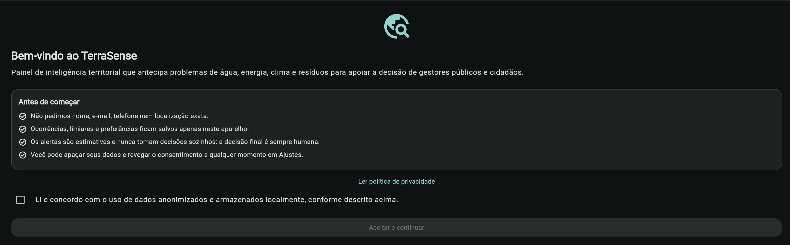 | 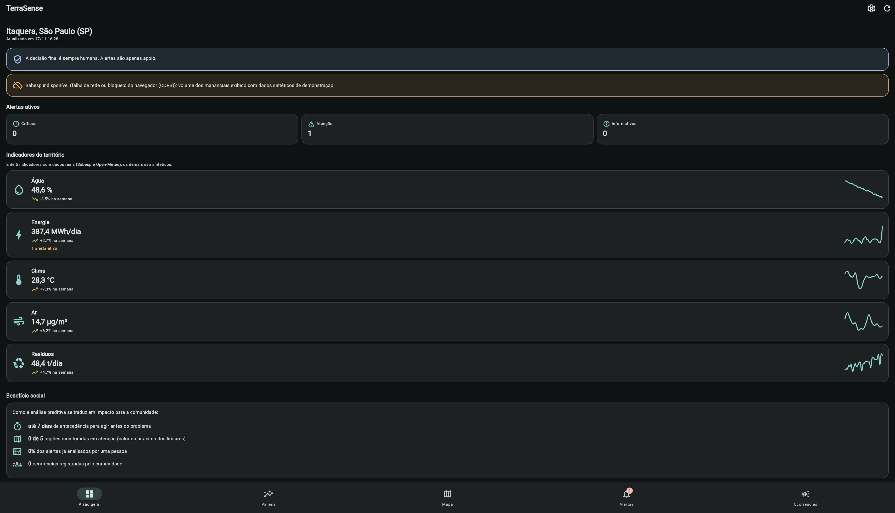 | 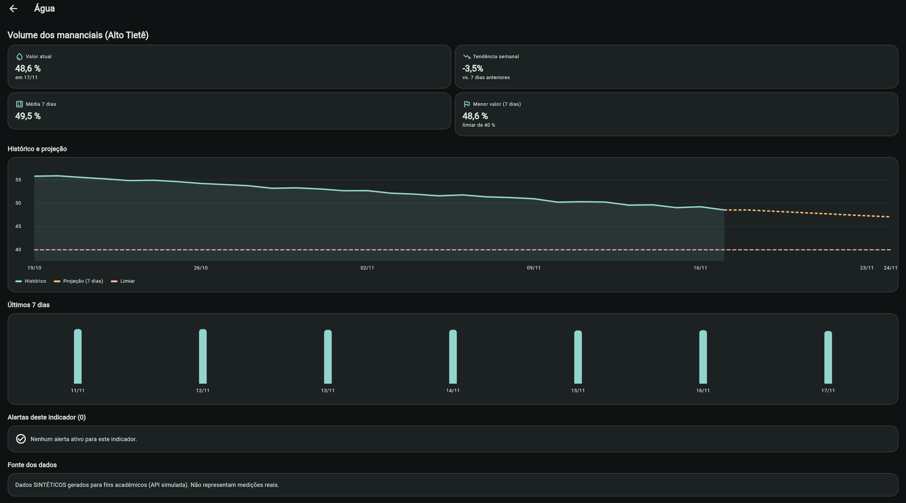 |
| Consentimento explícito e privacidade | Alertas ativos, indicadores e benefício social | Histórico, projeção de 7 dias e limiar |

| Painel de Energia | Painel de Clima | Painel de Resíduos |
|:--:|:--:|:--:|
| 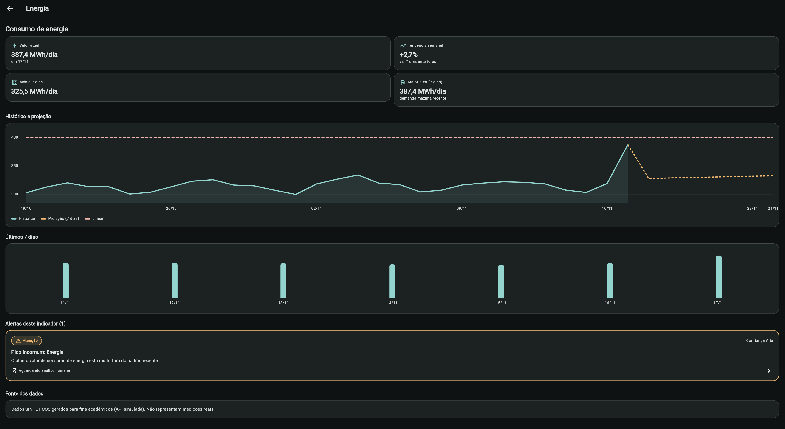 | 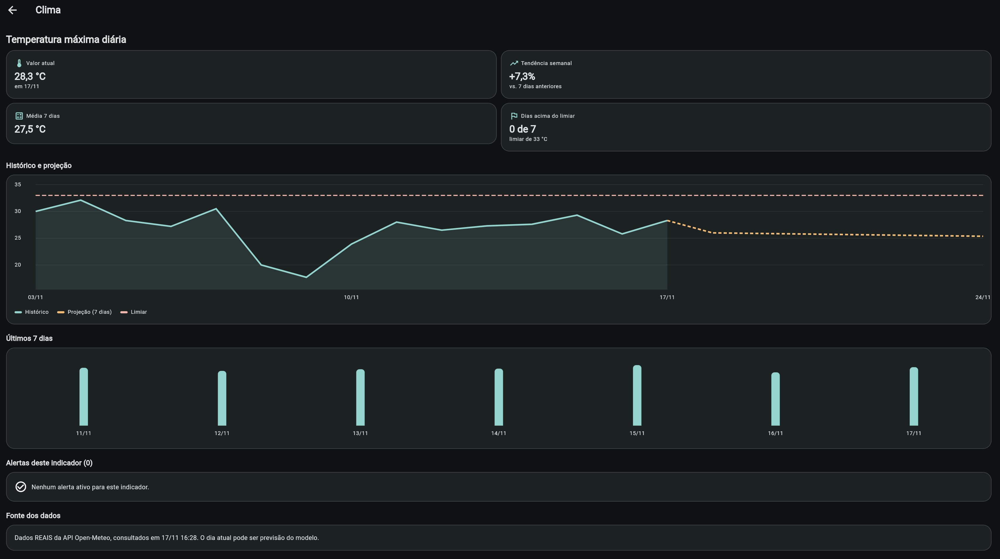 | 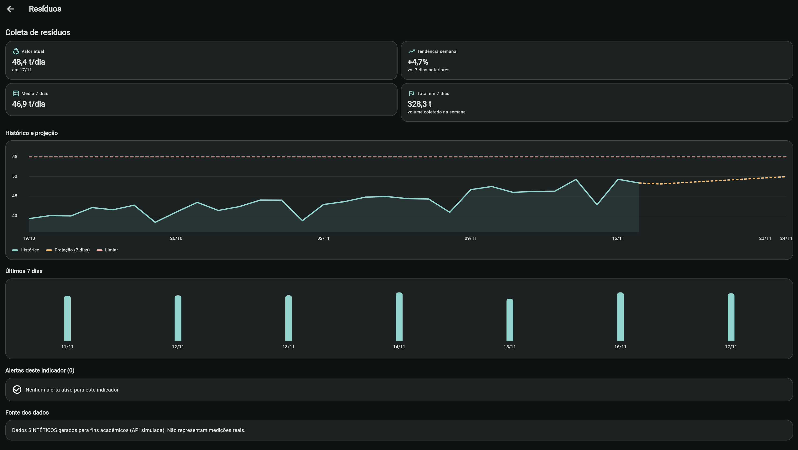 |
| Consumo e picos de demanda | Dados reais Open-Meteo | Volume coletado por dia |

| Mapa | Detalhe da região | Painel de Ar |
|:--:|:--:|:--:|
| 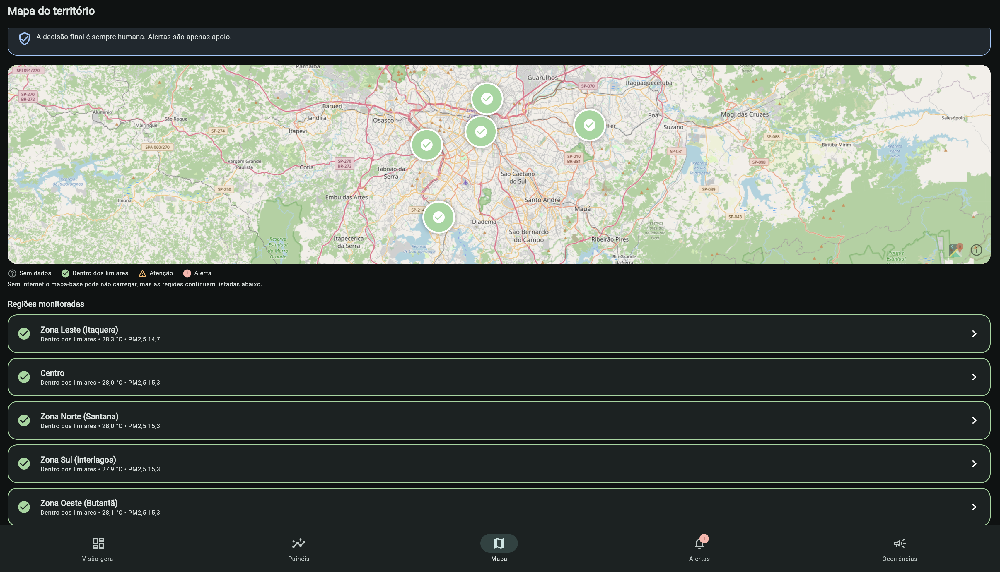 | 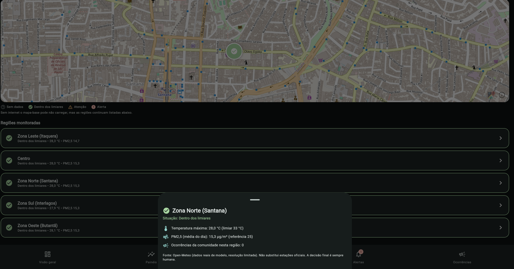 | 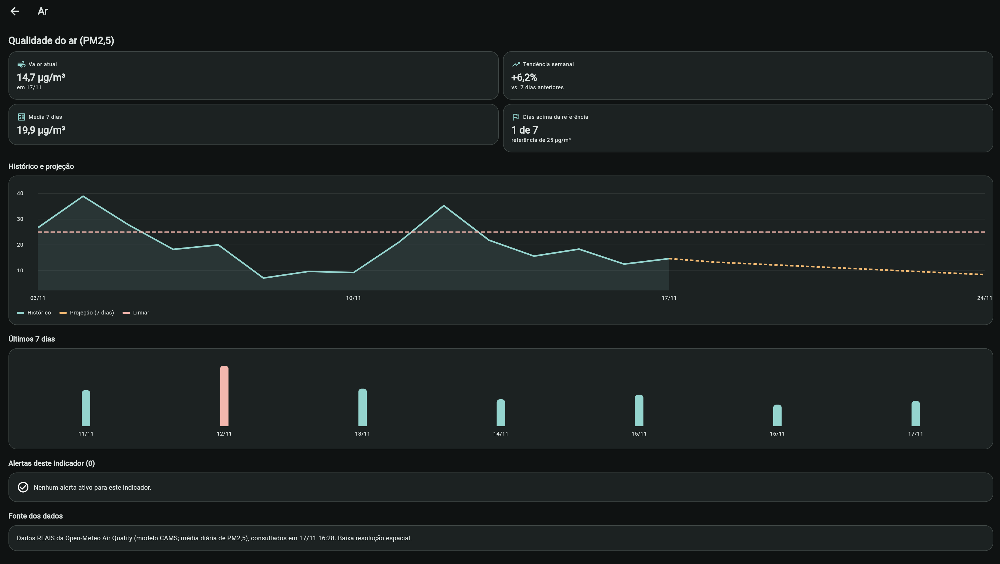 |
| Regiões de SP com status por cor e ícone | Clima, PM2,5 e ocorrências da região | PM2,5 real (Open-Meteo) | 

| Lista de alertas | Detalhe do alerta | Decisão humana |
|:--:|:--:|:--:|
| 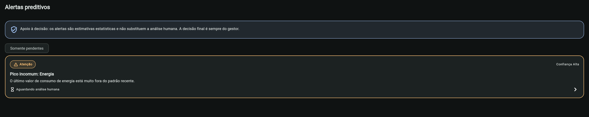 | 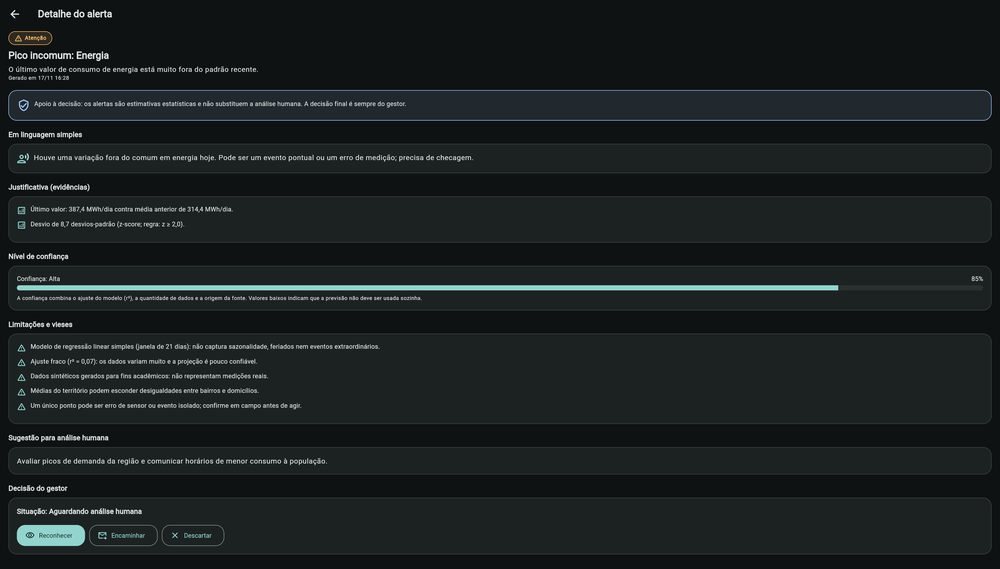 | 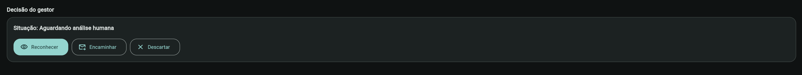 |
| Alertas por severidade e confiança | Evidências, confiança e limitações | Reconhecer, encaminhar ou descartar |

| Ocorrências | Formulário | Validação |
|:--:|:--:|:--:|
| 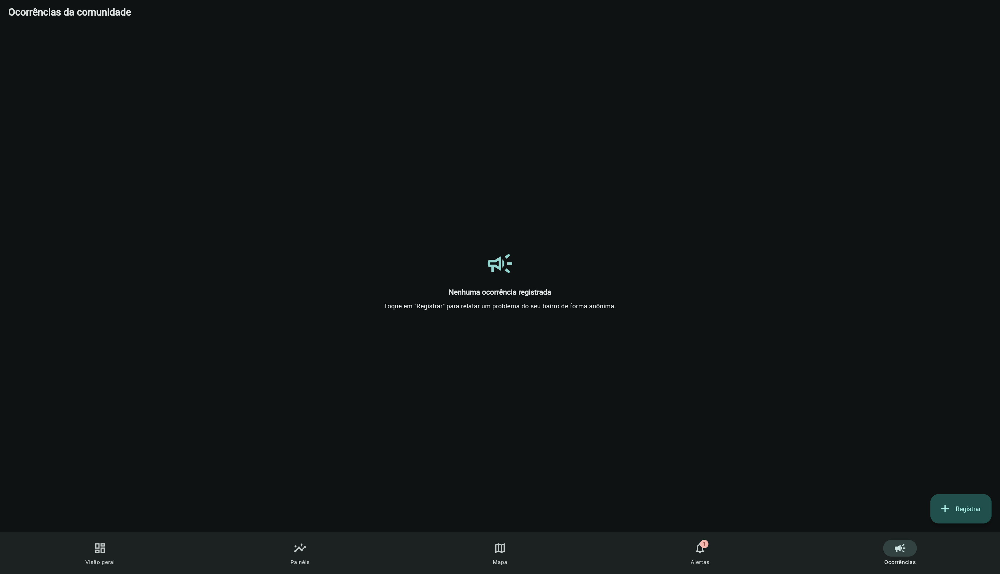 | 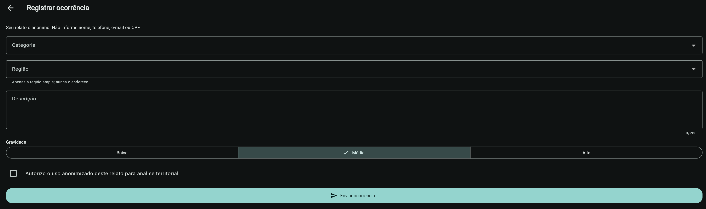 | 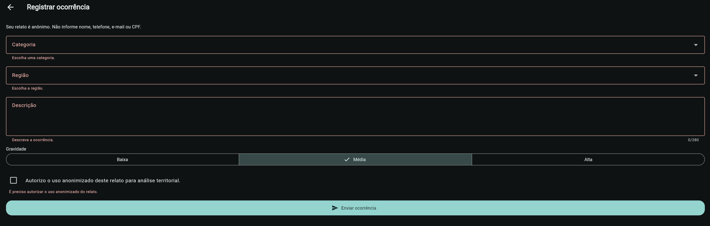 |
| Lista persistida localmente | Registro anônimo por região | Mensagens de erro e bloqueio de dados pessoais |

| Limiares | Ajustes | Tema escuro / alto contraste |
|:--:|:--:|:--:|
| 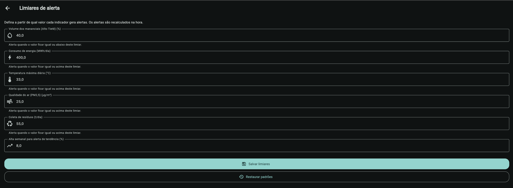 | 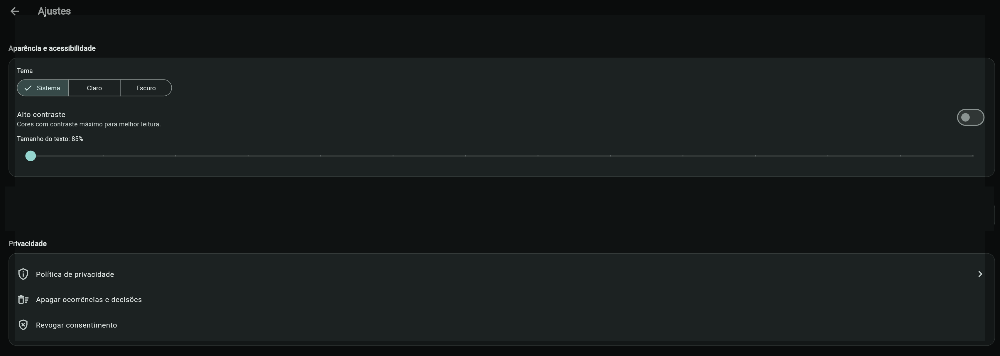 | 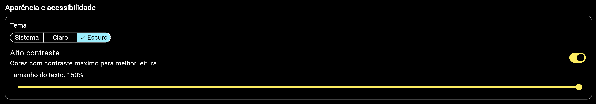 |
| Configuração dos limiares de alerta | Acessibilidade e privacidade | Temas e fonte ampliada |

## 4. Funcionalidades

- [x] Consentimento explícito na primeira execução e política de privacidade
- [x] Navegação com rotas nomeadas e parâmetros (visão geral → indicador → alerta)
- [x] 5 dashboards territoriais: água, energia, clima, qualidade do ar e resíduos
- [x] Gráficos de linha (histórico + projeção + limiar), barras e mini gráficos de tendência
- [x] **Mapa** (OpenStreetMap) com 5 regiões de São Paulo, status por cor + ícone e detalhe por região
- [x] **APIs públicas reais**: Sabesp (volume dos mananciais) e Open-Meteo (clima e qualidade do ar)
- [x] Alertas preditivos com justificativa, nível de confiança e limitações (suporta indicadores em que "menor é pior")
- [x] Aviso permanente de que a decisão final é humana + registro da decisão (reconhecer, encaminhar, descartar)
- [x] Explicação de cada alerta em linguagem simples para o cidadão (gerada por regras, sem LLM)
- [x] Estado global com Provider, compartilhado entre várias telas, com carregamento, erro e lista vazia
- [x] Persistência local: ocorrências, limiares, decisões, preferências e cache dos dados reais
- [x] Funciona offline (cache) com aviso visível da fonte e do motivo
- [x] Formulário de ocorrência anônima (região em lista) com validação
- [x] Formulário de limiares de alerta com validação (alertas e mapa recalculados na hora)
- [x] Indicadores de benefício social
- [x] Tema claro, escuro e alto contraste; fonte ajustável; suporte a leitor de tela
- [x] Testes automatizados (motor de alertas, validações e parsers das APIs)
- [ ] Notificações push e IA generativa (não implementados nesta versão)

## 5. Dados e alertas

**Fontes.**

| Indicador | Fonte | Tipo |
|---|---|---|
| Água: volume útil (%) do sistema **Alto Tietê** (abastece a zona leste) | API pública do [Portal dos Mananciais da Sabesp](https://mananciais.sabesp.com.br) (`/api/v4`, sem chave) | **Real** |
| Clima: temperatura máxima diária, por região | [Open-Meteo Forecast API](https://open-meteo.com/en/docs) (sem chave, CC BY 4.0) | **Real** |
| Ar: PM2,5 (média diária), por região | [Open-Meteo Air Quality API](https://open-meteo.com/en/docs/air-quality-api) (modelo CAMS) | **Real** |
| Energia e resíduos | `SyntheticDataService` (API simulada, determinística) | Sintético |

Não foi encontrada uma API pública estável e documentada para energia e resíduos do bairro, então essas duas séries são sintéticas e **sempre sinalizadas** no app. Se a Sabesp ou a Open-Meteo falharem, o app usa o cache local e, sem cache, dados sintéticos claramente rotulados.

> **Sobre a Sabesp:** o esquema do JSON da API v4 não é oficialmente documentado. O `SabespService` usa um parser tolerante (procura o campo de data e o de "volume útil %"). Se o formato mudar, o app avisa na tela e cai no fallback. Veja "Verificando a API da Sabesp" na seção 8.

**Como os alertas são gerados** (`lib/domain/alert_engine.dart`):

| Regra | Condição | Severidade |
|---|---|---|
| Limiar excedido | Último valor ≥ limiar configurado | Crítico |
| Projeção de limiar | Regressão linear (janela de até 21 dias) projeta valor ≥ limiar em 7 dias e a tendência é de alta | Atenção |
| Pico incomum | z-score do último valor contra o histórico ≥ 2,0 | Atenção |
| Tendência de alta | Média dos últimos 7 dias subiu ≥ X% (configurável) sobre os 7 anteriores, quando a regra de limiar não disparou | Informativo |

**Métricas usadas:** inclinação da reta (unidade/dia), r², desvio dos resíduos (faixa de ±1,96σ da projeção), z-score e variação semanal (%).

**Nível de confiança** (0 a 1): projeção = `0,2 + 0,7·r² − penalidades`; anomalia = `0,5 + 0,08·(z−2) − penalidades`; limiar excedido = `0,85 − penalidades`. Penalidades: janela com menos de 14 dias (−0,20), dados em cache (−0,15) e dados sintéticos (−0,05). Rótulos: Alta ≥ 70%, Média ≥ 45%, Baixa abaixo disso.

**Limitações e vieses.**
- Regressão linear simples: não captura sazonalidade anual, feriados, chuvas extremas nem eventos extraordinários.
- Dados sintéticos refletem as premissas de quem os gerou, não a realidade do bairro.
- Médias territoriais escondem desigualdades entre bairros e domicílios (por exemplo, quem tem menos acesso à água).
- O valor do dia atual de clima/ar pode ser previsão do modelo, não medição de estação.
- O volume do manancial mede a oferta de água do sistema, não o consumo nem a falta de água em cada bairro.
- Um único ponto anômalo pode ser erro de sensor.

**Mapa:** cada região recebe o status *Alerta* (temperatura e PM2,5 acima dos limiares), *Atenção* (um dos dois) ou *Dentro dos limiares*. A resolução espacial dos modelos é limitada (as regiões podem ter valores parecidos) e o PM2,5 não substitui as estações da CETESB.

**Quando as previsões NÃO são confiáveis:** r² baixo (< 0,3), menos de 14 dias de dados, dados em cache antigos, mudanças bruscas de regime (obras, racionamento, feriados longos) e projeções além de 7 dias. O app exibe essas limitações em cada alerta.

**Decisão humana.** O app nunca executa ações. Cada alerta exige análise do gestor, que registra a decisão (reconhecer, encaminhar ou descartar).

## 6. Privacidade e inclusão

**Privacidade**
- Tela de consentimento explícito antes do uso; revogável em Ajustes.
- Nenhum dado pessoal é solicitado (sem login, nome, e-mail, telefone ou GPS).
- Ocorrências usam apenas uma região ampla escolhida em lista (nunca endereço); o texto livre com e-mail, telefone ou CPF é bloqueado pela validação.
- Todos os dados ficam apenas no aparelho (SharedPreferences). As chamadas de rede externas (Sabesp, Open-Meteo e tiles do OpenStreetMap) não enviam nenhum dado do usuário.
- Opções para apagar ocorrências/decisões e revogar o consentimento.

**Acessibilidade**
- Contraste adequado (cores de severidade ajustadas para claro e escuro) e tema de **alto contraste**.
- Fonte ajustável no app (85% a 150%) combinada com o tamanho de fonte do sistema; layouts sem alturas fixas para texto.
- Rótulos semânticos (`Semantics`) em gráficos, cartões, selos de severidade e barra de confiança; `tooltip` em botões de ícone.
- Severidade nunca depende só da cor (ícone + texto).
- Localização `pt-BR` (leitores de tela e componentes do sistema em português).
- Alvos de toque de pelo menos 48 px.

## 7. Tecnologias e decisões técnicas

| Escolha | Justificativa |
|---|---|
| **Flutter 3 / Dart 3** | Um único código para Android e iOS, exigido pela disciplina. |
| **provider** | Gerenciamento de estado simples e testável. Três `ChangeNotifier` globais (`SettingsProvider`, `TerritoryProvider`, `OccurrencesProvider`) separados do estado local das telas (formulários, filtros, aba atual). |
| **Rotas nomeadas** (`onGenerateRoute`) | Navegação centralizada e com validação de parâmetros, sem dependência extra. |
| **fl_chart** | Gráficos de linha e barras personalizáveis, com linha de limiar e projeção tracejada. |
| **http** | Consumo das APIs da Sabesp e da Open-Meteo. |
| **flutter_map + latlong2** | Mapa com tiles do OpenStreetMap, sem chave de API (alternativa ao Google Maps, que exige chave e cobrança). |
| **shared_preferences** | Persistência leve (JSON) suficiente para ocorrências, limiares, decisões e cache dos dados reais. |
| **Motor de alertas puro** (`domain/`) | Regras sem dependência de UI, fáceis de testar e de auditar. |
| **Material 3 + tema próprio** | Cores, espaçamentos e componentes (`AppCard`, `KpiTile`, `SeverityChip`) padronizados em `core/theme` e `widgets/`. |
| **Fonte padrão do sistema** | Evita download de fontes e funciona 100% offline. |

**Estrutura de pastas**

```
lib/
├── main.dart / app.dart       # inicialização, providers, tema, rotas
├── core/                      # tema, rotas, utilitários (formatação, validação)
├── models/                    # Indicator, TerritoryAlert, Occurrence, Thresholds, SocialBenefit
├── domain/alert_engine.dart   # regressão, regras e confiança dos alertas
├── services/                  # Sabesp, Open-Meteo, API simulada, armazenamento local
├── providers/                 # estado global (Settings, Territory, Occurrences)
├── screens/                   # telas
└── widgets/                   # componentes reutilizáveis
test/                          # testes do motor de alertas e das validações
```

## 8. Como executar

**Pré-requisitos:** conexão com a internet na primeira execução (para buscar os dados reais e os tiles do mapa), [Flutter SDK 3.19+](https://docs.flutter.dev/get-started/install), Android Studio (emulador) ou um celular com depuração USB, e Git.

```bash
# 1. Clonar
git clone https://github.com/Joao-Vitor06/Global_Solution-Cross-Plataform.git
cd Global_Solution-Cross-Plataform

# 2. Gerar as pastas de plataforma (android/ios) sem sobrescrever o código do projeto
flutter create --org br.com.fiap --project-name territory_insights --platforms=android,ios .

# 3. Permitir internet no Android (necessário no APK de release) - funciona no macOS e no Linux
perl -0pi -e 's#(<manifest[^>]*>)#$1\n    <uses-permission android:name="android.permission.INTERNET"/>#' android/app/src/main/AndroidManifest.xml

# 4. Dependências
flutter pub get

# 5. Testes e análise estática
flutter test
flutter analyze

# 6. Rodar
flutter run
```

> **Variáveis de ambiente / chaves:** não são necessárias. Sabesp, Open-Meteo e OpenStreetMap são públicos e dispensam chave. Se no futuro usarem uma API com chave, passe-a com `--dart-define=API_KEY=...` e nunca a versione.

> No Windows (sem `perl`), abra `android/app/src/main/AndroidManifest.xml` e adicione `<uses-permission android:name="android.permission.INTERNET"/>` logo abaixo da tag `<manifest ...>`.

**Verificando a API da Sabesp (recomendado antes de gravar o vídeo)**

```bash
curl -s https://mananciais.sabesp.com.br/api/v4/dados/ultima-data
curl -s "https://mananciais.sabesp.com.br/api/v4/sistemas/65/dados/diario/2026-11-01/2026-11-10" | head -c 1500
```
Se a data e o volume aparecerem e o app mostrar "Dados REAIS ... Sabesp" no painel de Água, está integrado. Se o app mostrar o aviso de Sabesp indisponível, ajuste `SabespService` (campo de data/volume) conforme o JSON recebido.

**Gerar APK de release (diferencial)**

```bash
flutter build apk --release
# arquivo: build/app/outputs/flutter-apk/app-release.apk
```
Publique-o em *GitHub → Releases → Draft a new release → anexar o .apk*.

**Prints:** rode o app, use o botão de captura do emulador (ou `adb exec-out screencap -p > assets/screenshots/02_visao_geral.png`) e salve com os nomes usados na seção 3.

## 9. Vídeo

🎥 **Link:** `COLE_AQUI_O_LINK_DO_VIDEO` (máx. 3 minutos). O roteiro sugerido está em [`docs/ROTEIRO_VIDEO.md`](docs/ROTEIRO_VIDEO.md).

## 10. Licença

Projeto acadêmico, FIAP, Global Solution 2026.2. Uso educacional.
